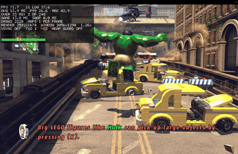
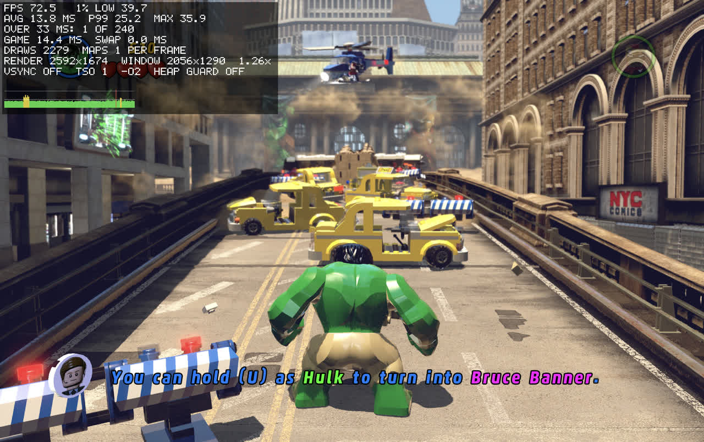

> [!IMPORTANT]
> This project does not include any game files. You need your own Steam copy of LEGO Marvel Super Heroes for Mac.

<h1 align="center">
  
  <br>
  Superheros Bricks Recompiled
</h1>

<p align="center">
  
  
  
</p>

<p align="center"><i>33-second video: <a href="docs/media/gameplay.mp4">gameplay.mp4</a></i></p>

The Mac version of LEGO Marvel Super Heroes (Feral Interactive) is a 32-bit Intel app, so it stopped working when macOS dropped 32-bit support. This project translates the game's code to C ahead of time and compiles it into a native arm64 app for Apple Silicon. You still need Rosetta 2 installed, but only for a small helper that compiles the game's shaders.

The translator and runtime are [MacRecomp](https://github.com/itsdunintime104/MacRecomp), the same engine that runs [Hobbit Recompiled](https://github.com/itsdunintime104/HobbitRecompiled).

This project is not affiliated with or endorsed by TT Games, Warner Bros. Games, Feral Interactive, Marvel or the LEGO Group.

## Contents

- [Requirements](#requirements)
- [Install](#install)
- [Playing](#playing)
- [Saves](#saves)
- [Status](#status)
- [Performance](#performance)
- [Troubleshooting](#troubleshooting)
- [Building and development](#building-and-development)
- [Credits](#credits)
- [Support](#support)
- [License](#license)

## Requirements

- A Mac with Apple Silicon (M1 or newer)
- LEGO Marvel Super Heroes for Mac from Steam, build 329428 (Steam app 249130)
- Xcode Command Line Tools
- Homebrew with SDL2 (needed to build; the app carries its own copy of SDL)
- Python 3.11 or newer
- Rosetta 2
- About 1 GB of free disk space

## Install

1. Install the game from Steam and let it finish updating.
2. Install the Xcode Command Line Tools, and wait until the installer says it is done:
   ```sh
   xcode-select --install
   ```
3. Install [Homebrew](https://brew.sh) if you do not have it, then the other tools:
   ```sh
   /bin/bash -c "$(curl -fsSL https://raw.githubusercontent.com/Homebrew/install/HEAD/install.sh)"
   brew install sdl2 python
   softwareupdate --install-rosetta --agree-to-license
   ```
4. Get the code and run the setup script:
   ```sh
   git clone --recurse-submodules https://github.com/itsdunintime104/SuperheroBrickRecomp.git
   cd SuperheroBrickRecomp
   ./setup.sh
   ```
5. Open **Superheros Bricks Recompiled** from `~/Applications`.

`setup.sh` checks your Mac, copies the game binary from your Steam folder, translates it, builds the app and installs it. It never changes the Steam folder. If something is missing, it tells you what and how to fix it. `./setup.sh --check` runs only that check.

If the game is in another Steam library, run `MARVEL_APP="/path/to/LEGO Marvel Super Heroes.app" ./setup.sh`. The app remembers that path.

| Option | Effect |
|---|---|
| `--check` | Only check the requirements |
| `--force` | Translate again. Use it after an update |
| `--no-install` | Build the app in `build.nosync/` without copying it to `~/Applications` |

To update to the latest version:

```sh
git pull && git submodule update --init && ./setup.sh --force
```

## Playing

| Key | Action |
|---|---|
| Cmd+Q | Quit |
| Cmd+F | Show or hide the performance overlay |

To change the resolution, use the resolution setting in the game's Options. It offers the full panel size, 75%, the desktop size and 50%.

Each run writes a log to `~/Library/Logs/MarvelRecomp/`. It holds startup messages, warnings and errors. It does not record what you do in the game. If the game stops, the last lines of the log say why. Attach the log when you report a problem. The log stays on your Mac, and the app keeps the newest 20.

## Saves

The game saves through Steam Cloud. Superheros Bricks Recompiled keeps those files in `~/Library/Application Support/MarvelRecomp/remote` instead. On the first run it copies your existing Steam Cloud saves there. After that it never writes to the Steam folder, so new saves do not sync to Steam Cloud.

The game keeps its settings, such as the resolution, in `~/Library/Application Support/Feral Interactive/LEGO Marvel Super Heroes/pcconfig.txt`.

> [!WARNING]
> Back up `~/Library/Application Support/MarvelRecomp/remote` before you play.

## Status

The intro, menus and the first level (Sand Central Station) work, with sound. Testing so far is one 32-minute session and a few shorter ones, all without a crash.

- Controllers are not tested yet.
- Achievements and stats are offline.
- Apple's Metal Performance HUD does not appear, because the game draws with OpenGL. Use the overlay (Cmd+F) instead.

## Performance

Tested on a MacBook Pro 16-inch (2021) with an M1 Max (10-core CPU, 32-core GPU, 32 GB) and macOS 26.6.2. The game draws with OpenGL 2.1 on Apple's Metal-based driver. Numbers are from the overlay, which measures the last 240 frames.

| Scene | Resolution | Frame rate | Frame time |
|---|---|---|---|
| Sand Central Station, played by hand | 2592 × 1674 | 72.5 FPS, 1% low 39.7 FPS | 13.8 ms average, 99% under 25.2 ms |
| Sand Central Station, while screen recording | 2592 × 1674 | 69–85 FPS | 11.7–14.5 ms average |



*Sand Central Station at 2592 × 1674 with the overlay.*

To record every frame time, start the app with the flag `MARVELRECOMP_FRAMELOG=1`. It then writes `~/Library/Logs/MarvelRecomp/frames-<date>_<time>.csv`:

```sh
open --env MARVELRECOMP_FRAMELOG=1 "$HOME/Applications/Superheros Bricks Recompiled.app"
```

To turn a CSV into a chart:

```sh
(cd engine && ../.venv/bin/python -m tools.perf.plot_frames ~/Library/Logs/MarvelRecomp/frames-<date>_<time>.csv)
```

## Troubleshooting

| Problem | Fix |
|---|---|
| Black window that never starts | Click the game window. macOS gave keyboard focus to another app |
| "game binary not found" | Install the game from Steam, or set `MARVEL_APP` as shown in [Install](#install) |
| `setup.sh` says the sha256 does not match | Only build 329428 works. Let Steam finish updating, and leave any beta branch |
| Black screen after the intro, or shaders fail | Install Rosetta 2: `softwareupdate --install-rosetta --agree-to-license` |
| macOS says the app is damaged | Build the app with `setup.sh` on your own Mac. A copy from another Mac does not run |

## Building and development

The [MacRecomp README](https://github.com/itsdunintime104/MacRecomp#readme) covers how the translation works, the build steps, the checks, debug options and tests. Run its `make` commands from the root of this repo.

## Credits

- **[xboxrecomp](https://github.com/sp00nznet/xboxrecomp)** by sp00nznet: the x86-to-C translator MacRecomp's translator is forked from (MIT license).
- **[SDL2](https://www.libsdl.org/)**: window, input and controllers (zlib license).
- **dlmalloc** by Doug Lea: the guest heap allocator (MIT-0).

## Support

[](https://buymeacoffee.com/itdunintime)

| Currency | Address |
|:---------|:--------|
| BTC | `1A7DmUpKRkuoSTKkWDcFR6SBdtpGqa1R8x` |
| ETH | `0x772a320ff05c763eae76868b971b6d53daee36e7` |
| SOL | `En858GF2YnTtTo4rmGfdTADof5gdVMGv1d13favtAbS5` |
| USDT (ERC-20) | `0x772a320ff05c763eae76868b971b6d53daee36e7` |

## License

GPL-3.0. See [LICENSE](LICENSE). Third-party code keeps its own license: see `engine/tools/xrecomp/LICENSE`, `engine/tools/xrecomp/NOTICE` and the header of `engine/runtime/src/dlmalloc.c`.

The repository contains no game assets, no game binary and no code generated from the game. `recon/` holds function addresses, import names and switch tables taken from the game binary, which the translator needs.
